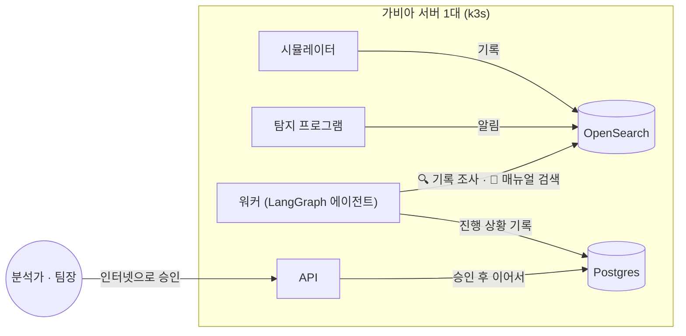

# 실습 안내: EDR AI 트리아지 에이전트 (2인 1조 · 3일)

## 무엇을 만드나

EDR 알림이 들어오면 **AI 에이전트가 PC의 기록을 조사하고, 회사 매뉴얼을 찾아보고, 판정과 대응 권고를 쓰고, 위험한 조치는 사람의 승인을 기다리는** 서비스입니다.
이 서비스를 가비아 서버의 k3s에 **직접 설정 파일을 쓰면서** 올리고, 일부러 고장 내고 고쳐 봅니다.

어떤 부품으로 이루어지는지는 사전 자료 [`01b_story_to_system.md`](../prep/01b_story_to_system.md)에 정리되어 있습니다.

## 읽는 순서

| 순서 | 문서 | 내용 |
|---|---|---|
| 사전 자료 | [`prep/01_edr_soc_intro.md`](../prep/01_edr_soc_intro.md) | EDR과 보안관제, 예시 알림, **역할 정하기** |
| | [`prep/01b_story_to_system.md`](../prep/01b_story_to_system.md) | 이야기를 부품으로, 고장 나는 곳 |
| | [`prep/02_troubleshooting.md`](../prep/02_troubleshooting.md) | 트러블슈팅 순서, 깨 보기, 런북, **고장 예상표** |
| | [`prep/03_references.md`](../prep/03_references.md) | 역할별 참고 링크 |
| 실습 | 이 문서 → [`DAY1.md`](DAY1.md) → [`DAY2.md`](DAY2.md) → [`DAY3.md`](DAY3.md) | 일차별 따라하기 |
| 인프라 | [`INFRA_STAGES.md`](INFRA_STAGES.md) | 0~7단계, 직접 작성 + 깨 보기 |
| 체크리스트 | [`WORK_SPEC.md`](WORK_SPEC.md) | 사전 자료~3일차 작업 번호, 결과물, 완료 기준 |
| 자료 | [`data/kb/README.md`](../../data/kb/README.md) | 분석할 PDF 9종, RAG 평가 질문 21개 |

## 역할

역할은 01 문서 6장에서 정합니다. 2장의 경비 비유로 말하면, 기록 담당은 **CCTV를 돌려 보는 사람**, 문서 담당은 **경비 매뉴얼을 펴 보는 사람**입니다.

| | 🔍 **기록 담당** | 📘 **문서 담당** |
|---|---|---|
| 다루는 자료 | 가상 회사 PC·서버의 활동 기록 (`data/telemetry/`, 시뮬레이터) | 대응 정책·플레이북 PDF 9종 (`data/kb/pdf/`) |
| 혼자 만드는 것 | 기록을 찾아 주는 **조사 도구** 3개 | 매뉴얼을 찾아 주는 **플레이북 검색(RAG)** |
| 검색 방식 | 조건이 정확한 검색 (term, range) | 의미로 찾는 검색 (파싱 → 청킹 → 임베딩 → 하이브리드) |
| 에이전트에서 쓰이는 곳 | ① 조사 | ③ 대응 권고 |
| 성과를 재는 방법 | 도구 테스트, 사람이 결과만 보고 판정할 수 있는가 | RAG 평가 (정답 문서가 상위 3개 안에 드는 비율) |

**함께 만드는 것:** 두 사람의 도구를 연결하는 **에이전트**, 서버에 올리는 **인프라**, 품질을 재는 **평가**
**바꿔서 해 보는 것:** 서로의 영역에 작은 작업을 하나씩. 그래야 상대가 만든 것도 설명할 수 있습니다.

## 작업 형태 표시

| 표시 | 뜻 | 원칙 |
|---|---|---|
| 👤 | **혼자** | 자기 영역을 처음부터 끝까지. 설명은 깊게 |
| 👥 | **짝과 함께** | 한 사람은 키보드(운전), 한 사람은 옆에서 방향 제시. 정해진 지점마다 교대 |
| 🔁 | **상대 영역** | 상대 영역에 작은 작업 하나. 상대가 리뷰 |
| 🔥 | **깨 보기** | 짝이 장애를 넣고 내가 찾기 → 런북에 기록 (02 문서 7장) |

**운전 원칙:** 에이전트를 만들 때는 **상대가 만든 도구를 내가 연결**합니다. 인프라는 단계마다 운전자가 정해져 있습니다 ([`INFRA_STAGES.md`](INFRA_STAGES.md)).

## 3일 흐름

| | 1일차 | 2일차 | 3일차 |
|---|---|---|---|
| 목표 | 계약, 각자 검색 계층, 에이전트 설계 | 에이전트 완성(가드레일, 사람 승인), 서버에 올리기 | 운영 완성, 고도화, 설명 |
| 👤 혼자 | 🔍 조사 도구 / 📘 플레이북 검색 | | 고도화 |
| 👥 함께 | 도구 계약, 인프라 0단계, 에이전트 뼈대 | 에이전트 완성, 평가 기준점, 인프라 1~5단계 | 인프라 6~7단계, Dify, 종합 드릴, 발표 |
| 🔁 상대 영역 | | 교차 작업 | 고도화 1개 |
| 팀 문서 | CONTRACT, ARCHITECTURE, DECISIONS, RUNBOOK | DECISIONS, CONTRACT(새 도구), CAPACITY, RUNBOOK | DEPLOYMENT(옆 팀 검증), POSTMORTEM, 발표 |
| 고장 예상표 (02 문서 9-2) | 개인 작업에서 확인 | 깨 보기 결과와 비교 | 최종 평가와 비교 |

## 코드에서 채울 곳 (TODO)

| 번호 | 담당 | 일차 | 내용 |
|---|---|---|---|
| `REC-1` | 🔍 | 1 | 텔레메트리 인덱스 템플릿 |
| `REC-2~4` | 🔍 | 1 | 조사 도구 3개 (프로세스 트리, 프로세스 활동, 호스트 타임라인) |
| `DOC-1~3` | 📘 | 1 | 파싱, 머리말·꼬리말 제거, 청킹 |
| `DOC-4~5` | 📘 | 1 | 플레이북 인덱스 매핑, 하이브리드 검색(RRF) |
| `G-1~2` | 👥 | 2 | 가드레일: 근거 추적, 악성 판정의 근거 개수 |
| `H-1~2` | 👥 | 2 | 사람 승인(interrupt), 상태 저장(Postgres) |
| `DIFY-1` | 👥 | 3 | Dify 연동용 점수 정규화 |

## 발표에서 각자 설명할 수 있어야 하는 것

- **내 영역 (깊게):** 왜 이 방식으로 검색했나, 무엇을 측정했고 결과가 어땠나, 고장 예상표는 맞았나
- **상대 영역 (짧게):** 상대 도구가 무엇을 받아 무엇을 돌려주고, 에이전트 어디서 쓰이나
- **공동 영역:** 에이전트가 사람 승인에서 멈추고 이어 가는 원리, 장애를 찾았던 과정 하나
